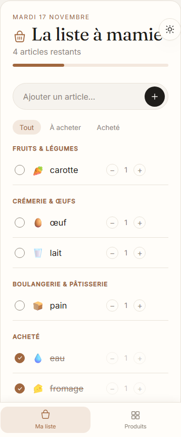
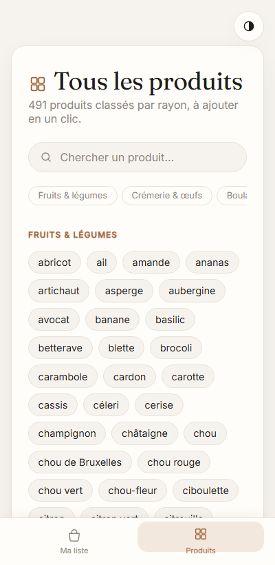
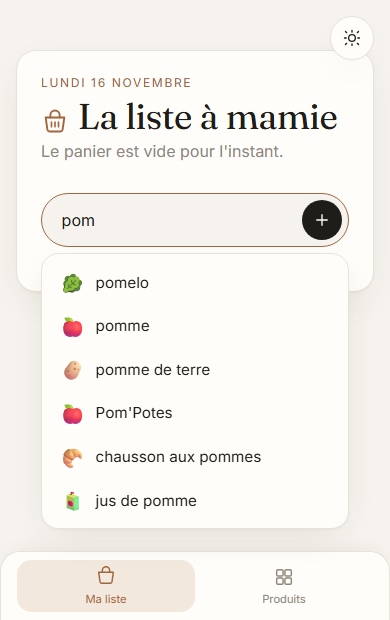
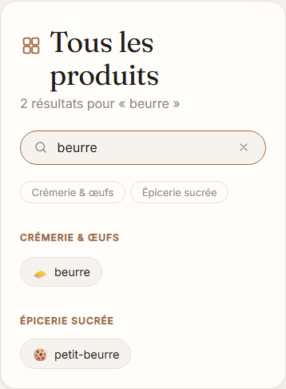
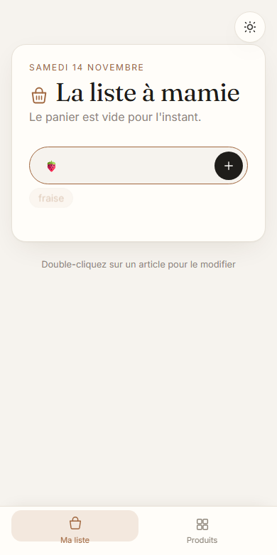
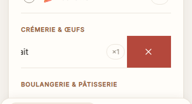

# La liste à mamie

<p align="center">
  
</p>

Une application de liste de courses simple, rapide et agréable à utiliser — avec
quantités, suggestions de produits, un catalogue de 553 produits (alimentaire et
non-alimentaire) classés par rayon, chacun avec son emoji, et une installation en PWA.

<p align="center">
  
  
  
</p>

## Fonctionnalités

- **Liste de courses** : ajouter un article (avec quantité), le cocher, le renommer
  (un clic sur le nom), ajuster sa quantité, filtrer (tout / à acheter / acheté),
  vider les articles achetés. Les articles « à acheter » sont groupés par rayon
  (dans l'ordre du catalogue) pour suivre facilement un parcours en magasin ; les
  articles cochés descendent automatiquement dans une section « Acheté » à part.
- **Anti-doublon** : impossible d'ajouter deux fois le même article.
- **Auto-complétion** : en tapant, un panneau flottant suggère des produits (avec
  leur emoji) à partir d'un dictionnaire de 553 produits courants, classés par
  pertinence (une correspondance exacte ou en début de nom remonte en premier).
- **Recherche par emoji** : taper ou coller directement un emoji (🍓) suggère le
  produit correspondant (« fraise »), aussi bien dans la liste que dans le
  catalogue.
- **Une icône pour chaque article** : chaque produit affiche un emoji qui lui est
  propre (🥕 pour « carotte », 🧀 pour « fromage »…) ; à défaut d'icône spécifique,
  l'icône du rayon s'affiche, et pour un article personnalisé absent du catalogue,
  l'emoji caddie 🛒 sert de repli — un article n'est donc jamais sans icône.
- **Catalogue par rayon** (page « Produits ») : tous les produits groupés par
  catégorie — fruits & légumes, crémerie, boulangerie, viandes & poissons, épicerie
  salée/sucrée, boissons, surgelés, hygiène & entretien, mais aussi **bébé, animaux
  et droguerie & bricolage** pour les courses qui ne sont pas que alimentaires —
  avec recherche en direct (classée par pertinence, comme l'auto-complétion) et
  navigation rapide par rayon.
- **Annulation de suppression** : supprimer un article affiche un bandeau
  « Annuler » pendant quelques secondes.
- **PWA installable**, fonctionne hors-ligne, icône et manifeste dédiés.
- **Mise à jour automatique** : dès qu'une nouvelle version est déployée, un
  bandeau « Nouvelle version disponible » propose de recharger en un clic — plus
  besoin de vider le cache manuellement pour récupérer les nouveautés.
- **Badge sur l'icône de l'app** : une fois installée, l'icône affiche le nombre
  d'articles restants à acheter, sans avoir besoin d'ouvrir l'app (selon le
  support du navigateur/OS pour la Badging API).
- **Responsive** : utilisable du petit téléphone au grand écran, menu de
  navigation mobile en bas d'écran.
- **Article compact sur tactile** : sur mobile, la quantité devient un badge
  `×2` qui se déplie au tap (au lieu des boutons `−`/`+` toujours visibles), et
  la suppression se fait en swipant l'article vers la gauche — de quoi laisser
  la place au nom du produit même quand il est long (ex. « après-shampoing »).
  La version desktop ne change pas (steppers et bouton supprimer toujours
  visibles comme avant).
- **Thème clair/sombre** : le bouton en haut à droite bascule entre thème clair et
  thème sombre, choix mémorisé. Au tout premier lancement, l'app démarre sur le
  thème du système.
- Animations et transitions soignées, respectueuses de `prefers-reduced-motion`.

<p align="center">
  
  
  
  
  
  
  
  
</p>

## Stack technique

- [Angular 22](https://angular.dev) — composants standalone, signaux, zoneless
- [Vitest](https://vitest.dev) pour les tests unitaires
- Service worker (`@angular/service-worker`) pour le support PWA
- SCSS, sans framework CSS

## Démarrer le projet

```bash
npm install
npm start          # lance l'app en local sur http://localhost:4200
```

Autres commandes utiles :

```bash
npm test           # tests unitaires (Vitest)
npm run build      # build de production (dist/la-liste-a-mamie)
```

## Contribuer

Les règles de code et l'architecture du projet sont décrites dans
[`CLAUDE.md`](./CLAUDE.md) (organisation des pages, conventions TypeScript/Angular,
règles d'accessibilité et d'UX à respecter).
