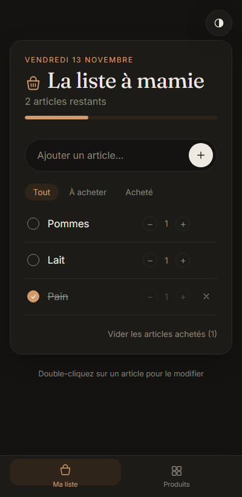

# La liste à mamie 🧺

Une application de liste de courses simple, rapide et agréable à utiliser — avec
quantités, suggestions de produits, un catalogue de 491 produits classés par rayon,
et une installation en PWA.

<p align="center">
  
  
  
</p>

## Fonctionnalités

- **Liste de courses** : ajouter un article (avec quantité), le cocher, le renommer
  (double-clic), ajuster sa quantité, filtrer (tout / à acheter / acheté), vider les
  articles achetés. Les articles cochés descendent automatiquement en bas de liste.
- **Anti-doublon** : impossible d'ajouter deux fois le même article.
- **Auto-complétion** : en tapant, l'app suggère des produits à partir d'un
  dictionnaire de 491 produits courants.
- **Catalogue par rayon** (page « Produits ») : tous les produits groupés par
  catégorie (fruits & légumes, crémerie, boulangerie, viandes & poissons, épicerie
  salée/sucrée, boissons, surgelés, hygiène…), avec recherche en direct et
  navigation rapide par rayon.
- **Annulation de suppression** : supprimer un article affiche un bandeau
  « Annuler » pendant quelques secondes.
- **PWA installable**, fonctionne hors-ligne, icône et manifeste dédiés.
- **Responsive** : utilisable du petit téléphone au grand écran, menu de
  navigation mobile en bas d'écran.
- **Thème clair/sombre** : suit le système par défaut, ou se force manuellement via
  le bouton en haut à droite (clair / sombre / auto), préférence mémorisée.
- Animations et transitions soignées, respectueuses de `prefers-reduced-motion`.

<p align="center">
  
</p>

## Stack technique

- [Angular 22](https://angular.dev) — composants standalone, signaux, zoneless
- [Vitest](https://vitest.dev) pour les tests unitaires
- Service worker (`@angular/service-worker`) pour le support PWA
- SCSS, sans framework CSS

## Démarrer le projet

```bash
npm install
npm start          # lance l'app en local sur http://localhost:4200
```

Autres commandes utiles :

```bash
npm test           # tests unitaires (Vitest)
npm run build      # build de production (dist/la-liste-a-mamie)
```

## Contribuer

Les règles de code et l'architecture du projet sont décrites dans
[`CLAUDE.md`](./CLAUDE.md) (organisation des pages, conventions TypeScript/Angular,
règles d'accessibilité et d'UX à respecter).
