# La liste à mamie

<p align="center">
  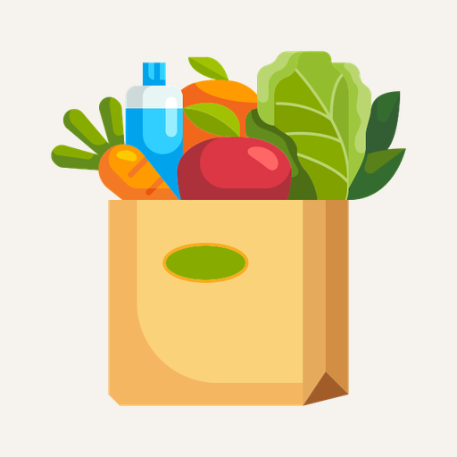
</p>

Une application de liste de courses simple, rapide et agréable à utiliser — avec
quantités, suggestions de produits, un catalogue de 554 produits (alimentaire et
non-alimentaire) classés par rayon, chacun avec son emoji, et une installation en PWA.

<p align="center">
  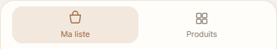
</p>

Deux pages, accessibles via le menu du bas : **Ma liste**, pour les courses en
cours, et **Produits**, le catalogue complet à parcourir.

## La liste de courses

Les articles « à acheter » sont groupés par rayon (dans l'ordre du catalogue) pour
suivre facilement un parcours en magasin. Un article se renomme d'un simple clic sur
son nom, sa quantité s'ajuste avec `−`/`+`, et il descend automatiquement dans une
section « Acheté » à part une fois coché — avec un bouton pour vider les articles
achetés en bloc.

<p align="center">
  
  
  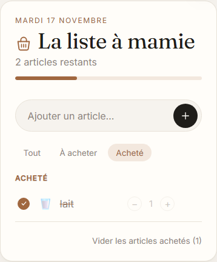
</p>

Impossible d'ajouter deux fois le même article (anti-doublon, insensible à la
casse). Et toute suppression — un article, ou tous les articles achetés d'un coup —
affiche un bandeau « Annuler » pendant quelques secondes : rien n'est jamais perdu
par erreur.

<p align="center">
  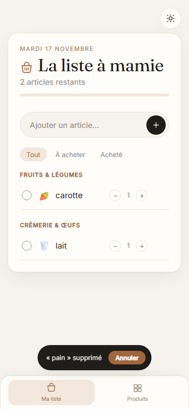
</p>

## Suggestions et recherche intelligente

En tapant le début d'un nom, un panneau flottant suggère des produits du catalogue
avec leur emoji, classés par pertinence : une correspondance exacte ou en début de
nom remonte avant une simple correspondance en milieu de mot (chercher « eau » fait
remonter « eau » avant « poireau » ou « gâteau »).

<p align="center">
  
  
</p>

Taper ou coller directement un emoji suggère le produit correspondant — aussi bien
dans la liste que dans le catalogue.

## Le catalogue de produits

La page « Produits » regroupe les 554 produits du catalogue par rayon — fruits &
légumes, crémerie, boulangerie, viandes & poissons, épicerie salée/sucrée, boissons,
surgelés, hygiène & entretien, mais aussi **bébé, animaux et droguerie &
bricolage** pour les courses qui ne sont pas que alimentaires. Chaque produit
s'ajoute à la liste en un clic.

<p align="center">
  
  
</p>

La recherche est classée par pertinence, comme l'auto-complétion de la liste : le
rayon contenant la meilleure correspondance remonte en premier. Et le catalogue ne
se limite pas à l'alimentaire.

<p align="center">
  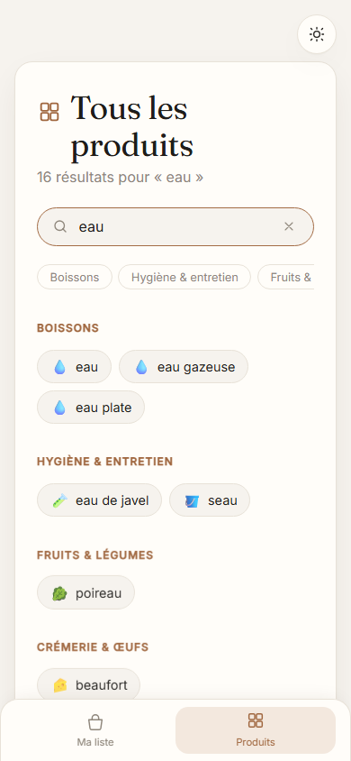
  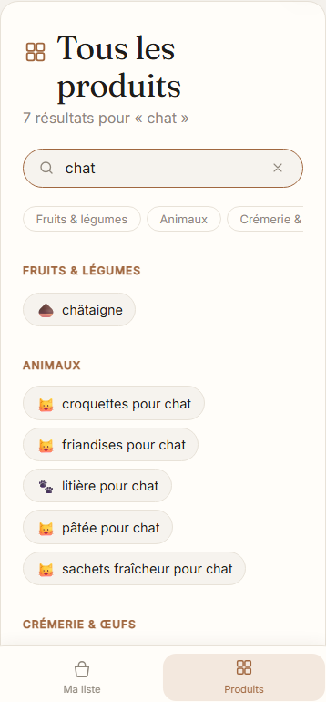
</p>

Un produit déjà ajouté reste cliquable : un second clic le retire de la liste, avec
la même annulation que depuis la liste elle-même.

<p align="center">
  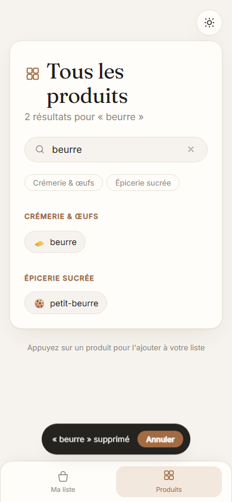
</p>

## Une icône pour chaque article

Chaque produit affiche un emoji qui lui est propre (🥕 pour « carotte », 🧀 pour
« fromage »…) ; à défaut d'icône spécifique, l'icône de son rayon s'affiche, et pour
un article personnalisé absent du catalogue, l'emoji caddie 🛒 sert de repli — un
article n'est donc jamais sans icône.

## Pensé pour le tactile

Sur mobile, deux éléments habituellement toujours visibles laissent la place au nom
du produit, même long (ex. « après-shampoing ») : la quantité devient un badge
compact `×2` qui se déplie au tap, et la suppression se fait en swipant l'article
vers la gauche. La version desktop ne change pas — steppers et bouton supprimer
restent toujours visibles.

<p align="center">
  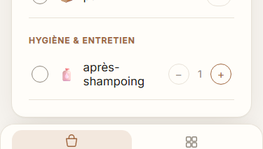
  
</p>

## Thème clair / sombre

Un bouton flottant en haut à droite bascule entre thème clair et thème sombre, choix
mémorisé d'une visite à l'autre. Au tout premier lancement, sans choix enregistré,
l'app démarre sur le thème du système.

<p align="center">
  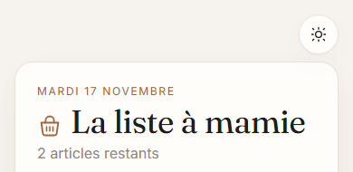
</p>

## Installable et toujours à jour (PWA)

L'application s'installe comme une app native et fonctionne hors-ligne. Dès qu'une
nouvelle version est déployée, un bandeau propose de recharger en un clic — plus
besoin de vider le cache manuellement pour récupérer les nouveautés. Une fois
installée, l'icône de l'app affiche en badge le nombre d'articles restants à
acheter, sans avoir besoin de l'ouvrir (selon le support du navigateur/OS pour la
Badging API).

<p align="center">
  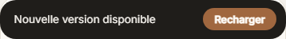
</p>

## Responsive

L'application reste utilisable et lisible du petit téléphone au grand écran, avec la
même base de code — pas de version mobile séparée.

<p align="center">
  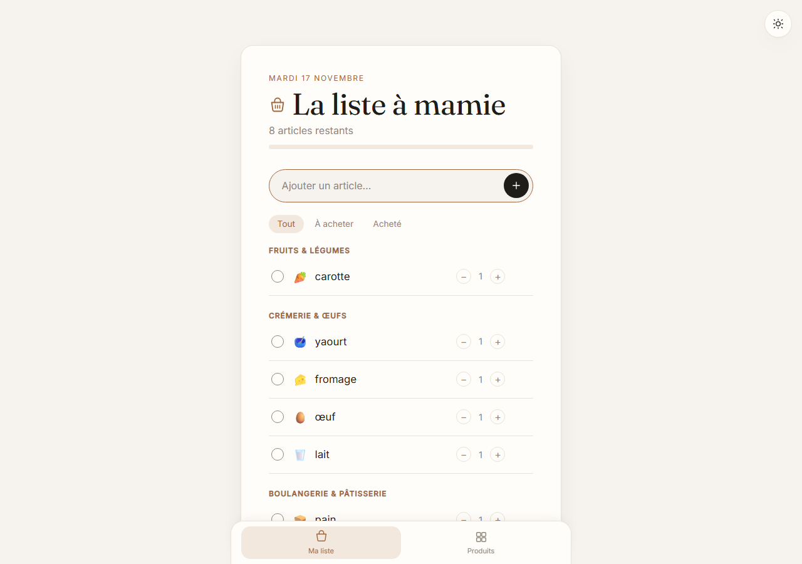
</p>

Animations et transitions soignées tout du long, respectueuses de
`prefers-reduced-motion`.

## Stack technique

- [Angular 22](https://angular.dev) — composants standalone, signaux, zoneless
- [Vitest](https://vitest.dev) pour les tests unitaires
- Service worker (`@angular/service-worker`) pour le support PWA
- SCSS, sans framework CSS

## Démarrer le projet

```bash
npm install
npm start          # lance l'app en local sur http://localhost:4200
```

Autres commandes utiles :

```bash
npm test           # tests unitaires (Vitest)
npm run e2e        # tests de bout en bout (Playwright, desktop + mobile)
npm run build      # build de production (dist/la-liste-a-mamie)
```

## Contribuer

Les règles de code et l'architecture du projet sont décrites dans
[`CLAUDE.md`](./CLAUDE.md) (organisation des pages, conventions TypeScript/Angular,
règles d'accessibilité et d'UX à respecter).
